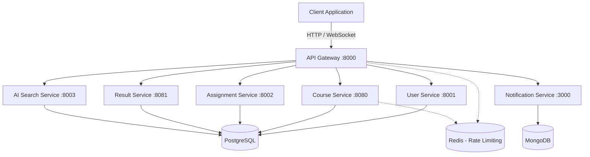

# AI-Powered Distributed Learning Management System (LMS)

A production-ready, microservice-based backend for a modern Learning Management System. 
This project fulfills the requirements for an advanced Database Engineering & Microservices academic demonstration.

## Features
- **Role-Based Access Control (RBAC):** Students, Teachers, and Admins.
- **Microservices Architecture:** 5 core services + API Gateway + AI Search.
- **Distributed Databases:** PostgreSQL (ACID relational data) + MongoDB (Event/Notification data) + Redis (Rate limits, caching).
- **AI-Powered Semantic Search:** Upload lecture PDFs, generate embeddings, and search via `pgvector`.
- **Real-Time Notifications:** Socket.IO integrated with MongoDB for real-time alerting.

## Technology Stack
- **API Gateway:** FastAPI
- **User Service:** FastAPI + PostgreSQL + SQLAlchemy
- **Course Service:** Spring Boot + PostgreSQL + JPA
- **Assignment Service:** FastAPI + PostgreSQL
- **Result Service:** Spring Boot + PostgreSQL
- **Notification Service:** Node.js + Express + Socket.IO + MongoDB
- **AI Search Service:** FastAPI + pgvector + PyPDF2

## System Architecture



## Quick Start (Docker Compose)

1. Clone the repository.
2. Copy the environment configuration:
   ```bash
   cp .env.example .env
   ```
3. Start the entire infrastructure (Databases + Microservices + API Gateway + Monitoring):
   ```bash
   docker compose up -d
   ```
4. **Seed the database:** (The Postgres initialization script automatically runs on first boot).
5. Access the API Gateway at `http://localhost:8000`.
6. Access Swagger/OpenAPI docs for individual services via their specific ports (e.g. `http://localhost:8001/docs` for User Service).

## Security & Best Practices
- **Passwords:** Hashed via bcrypt; never stored in plaintext.
- **JWT:** Access tokens generated statelessly and validated across services via the Gateway.
- **Rate Limiting:** IP and endpoint-specific rate limiting applied at the API Gateway using Redis.
- **File Uploads:** Validated for MIME type and size before processing for AI extraction.

## Documentation
- [Database & ER Model](./docs/database/README.md)
- [API Endpoints](./docs/api/README.md)
- [Advanced SQL Examples](./docs/sql-examples/README.md)
