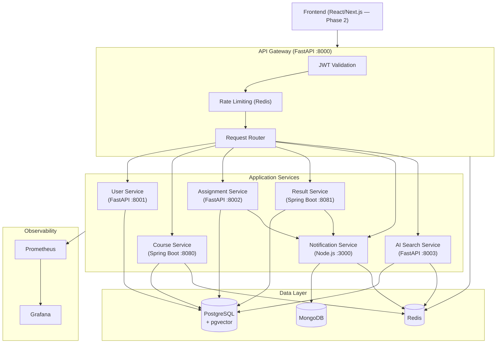
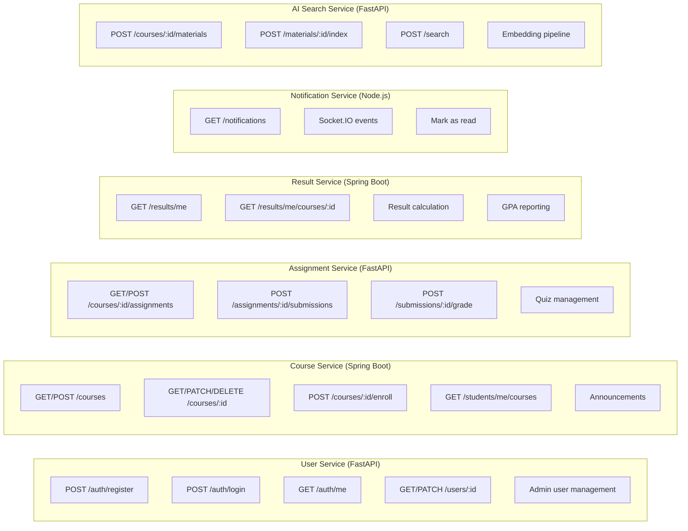
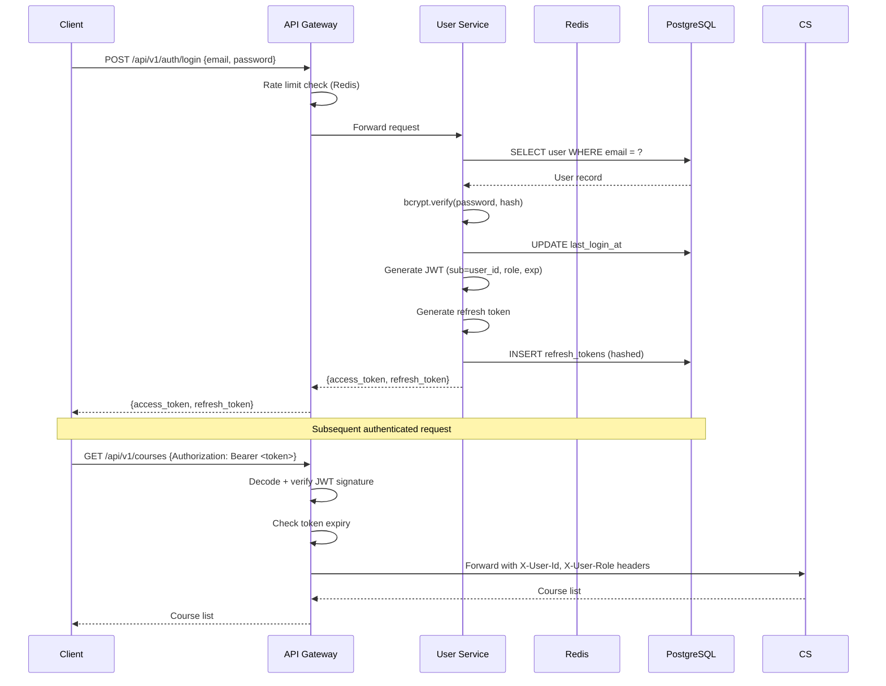
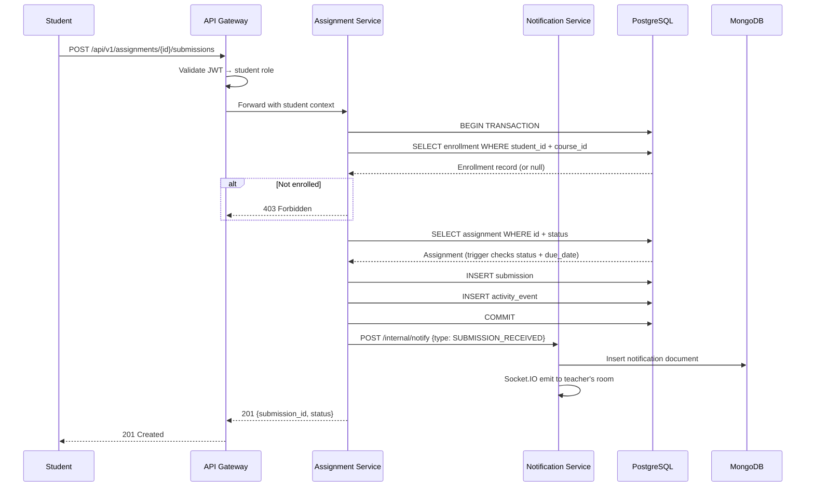
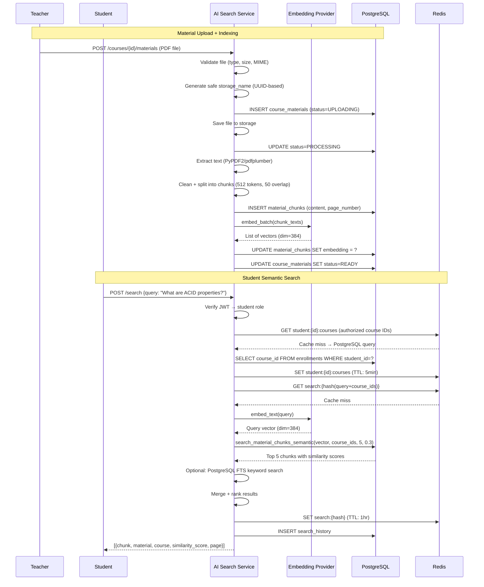
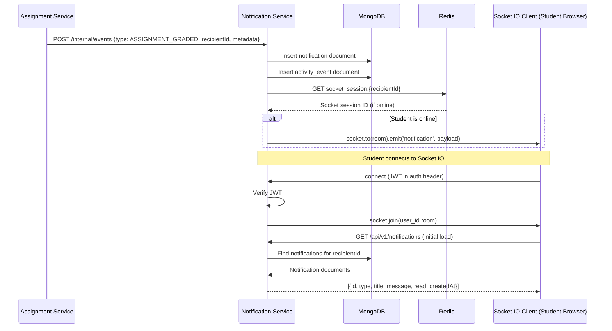

# System Architecture Documentation

## AI-Powered Distributed LMS

---

## 1. System Architecture

---

## 2. Service Responsibilities

---

## 3. Authentication Flow

---

## 4. Assignment Submission Flow

---

## 5. AI Search Flow

---

## 6. Notification Flow

---

## 7. Service Ownership — Database Tables

| Service | Owns These Tables | Communicates With |
|---|---|---|
| User Service | users, roles, user_roles, students, teachers, refresh_tokens | Used by all services via JWT |
| Course Service | courses, enrollments, announcements | User Service (user info) |
| Assignment Service | assignments, submissions, submission_grades, quizzes, quiz_* | Course Service (enrollment check), Notification Service |
| Result Service | course_results, result_components | Assignment Service (grades), Notification Service |
| AI Search Service | course_materials, material_chunks, embedding_jobs, search_cache, search_history | Course Service (enrollment auth) |
| Notification Service | MongoDB: notifications, activity_events | All services (receives events) |

**Cross-service rule:** No service directly reads or writes another service's tables. Data is exchanged through HTTP APIs or JWT claims.
