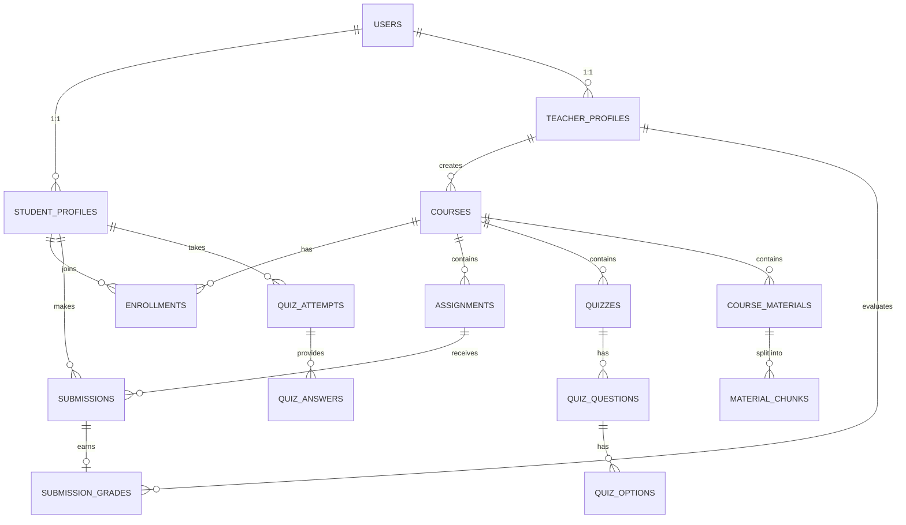

# LMS Database Design & Architecture

This document describes the database strategy, schema design, and engineering principles used for the AI-Powered Distributed LMS.

## Database Selection
1. **PostgreSQL**: The primary relational database and sole source of truth for strongly related LMS data (users, courses, enrollments, submissions, grades). It ensures ACID compliance, transactional integrity, and strong relationships.
2. **pgvector**: PostgreSQL extension used to store lecture material embeddings and perform Approximate Nearest Neighbor (ANN) vector similarity search. We keep embeddings close to the relational metadata (course materials) to simplify hybrid search and permissions.
3. **MongoDB**: Used exclusively by the Notification Service for flexible, event-oriented data that does not require relational transactions (e.g. Activity logs and Notifications).
4. **Redis**: Used for short-lived data, caching, and rate limiting at the API Gateway. It is treated purely ephemerally.

## ER Model

## Normalization & Integrity
The database strictly adheres to **3rd Normal Form (3NF)**:
1. **1NF**: All columns are atomic. No multi-valued columns.
2. **2NF**: No partial dependency of any column on the primary key.
3. **3NF**: No transitive dependencies. E.g. `student_id` maps to a `STUDENT_PROFILES` table, decoupling student-specific attributes from the generic `USERS` authentication data.

## Indexing Strategy
Indexes are applied selectively to avoid write penalties.
- `idx_users_email_lower`: Ensures rapid authentication lookups.
- `idx_enrollments_student_id`: Speeds up "My Courses" views.
- `idx_material_chunks_embedding_hnsw`: An HNSW approximate nearest-neighbor index for `pgvector` to ensure fast semantic search without scanning every text chunk linearly.

## ACID, Isolation, and MVCC
- **Atomicity**: Complex operations (like submitting an assignment and creating an activity log) are wrapped in `BEGIN ... COMMIT` blocks.
- **MVCC**: We rely on PostgreSQL's Multi-Version Concurrency Control. Read operations (a student viewing course material) never block write operations (a teacher grading submissions).
